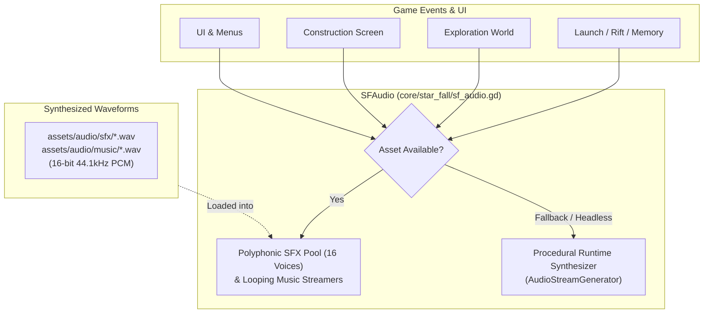

# STAR FALL: Phase 1 Audio Design & Asset Specification

## 1. Overview & Architecture

STAR FALL features a dual-layer retro sci-fi audio architecture designed for high emotional immersion, rich tactile feedback, and total runtime resilience:



### Key Technical Pillars:
1. **Zero-Dependency Synthesis**: All 35 sound files are synthesized using standard library Python (`wave`, `struct`, `math`, `random`, `array`) in `tools/generate_phase1_audio.py`. No external binaries, soundfonts, or heavy pip packages are required.
2. **Audio Specifications**:
   - Format: 16-bit signed PCM WAV.
   - Sample Rate: 44,100 Hz.
   - Channel Configuration: Mono for directional/character blips, footsteps, and ticks; Stereo for ambient soundscapes, spatial sweeps, explosive impacts, and chimes.
   - Headroom & Dynamics: Normalized to -1.0 dBFS (peak factor ~0.85–0.92) with soft-knee saturation to prevent clipping and eliminate digital wrap-around.
   - Anti-Click Envelopes: Every waveform incorporates raised-cosine / cubic attack and release envelopes to guarantee zero DC clicks or pop artifacts.
   - Seamless Looping: Ambient soundscapes (`ambience_earth.wav` and `ambience_ruin.wav`) feature equal-power cross-fade loop points for continuous, click-free cycling.
3. **Fail-Safe Fallback**: `core/star_fall/sf_audio.gd` preloads sample assets into an `AudioStreamPlayer` pool. If a file is missing or Godot is running in headless unit-test mode, the audio manager instantly falls back to its built-in procedural synthesizer, ensuring zero errors in CI/headless environments.

---

## 2. Audio Asset Inventory

| File Path | Duration | Channels | Size | Sonic Character | Gameplay Trigger Point |
|---|---|---|---|---|---|
| `assets/audio/sfx/ui_select.wav` | 0.04s | Mono | 4,012 B | 540 Hz -> 720 Hz snappy pulse click | Menu cursor movement, button focus |
| `assets/audio/sfx/ui_confirm.wav` | 0.28s | Stereo | 49,436 B | C5 -> G5 ascending major triad arpeggio | Menu confirmation, primary selection |
| `assets/audio/sfx/ui_back.wav` | 0.12s | Mono | 10,628 B | 420 Hz -> 180 Hz exponential downward glide | Menu cancel, back navigation |
| `assets/audio/sfx/ui_denied.wav` | 0.20s | Mono | 17,684 B | 130 Hz dual-pulse sawtooth/square buzzer | Invalid action, blocked path, locked slot |
| `assets/audio/sfx/ui_toast.wav` | 0.40s | Stereo | 70,604 B | D6-F#6-A6 sparkling FM chime triad | Popup banner notification (`ui.notify()`) |
| `assets/audio/sfx/blip_nick.wav` | 0.04s | Mono | 3,396 B | 370 Hz -> 330 Hz warm rounded triangle blip | Nick dialogue printing |
| `assets/audio/sfx/blip_bill.wav` | 0.03s | Mono | 2,866 B | 820 Hz FM modulated robotic chirp (1640 Hz mod) | Bill robot dialogue printing |
| `assets/audio/sfx/blip_control.wav` | 0.04s | Mono | 4,012 B | 1120 Hz bandpassed VHF radio telemetry chirp | Spaceport Mission Control dialogue |
| `assets/audio/sfx/interact.wav` | 0.14s | Stereo | 24,740 B | Micro-switch click + 880/1320 Hz dual harmonic ping | Terminal activation, NPC prompt interaction |
| `assets/audio/sfx/ship_install.wav` | 0.35s | Stereo | 61,784 B | Heavy friction slide + 85 Hz punch + hydraulic snap | Installing spacecraft component into hull |
| `assets/audio/sfx/ship_remove.wav` | 0.25s | Stereo | 44,144 B | High-pressure pneumatic burst + 330/240 Hz unlatch | Removing component from spacecraft hull |
| `assets/audio/sfx/fuel_tick.wav` | 0.06s | Mono | 5,776 B | 700 Hz -> 240 Hz fluid bubble pop + detent click | Adjusting propellant slider notches |
| `assets/audio/sfx/preflight_scan.wav` | 0.45s | Stereo | 79,424 B | 3 rapid ascending chirps (450-1600 Hz) + clock pulse | Initiating preflight systems diagnostic |
| `assets/audio/sfx/preflight_pass.wav` | 0.60s | Stereo | 105,884 B | C5-E5-G5-C6 major fanfare + FM shimmer echo | Preflight check all-green / valid design |
| `assets/audio/sfx/preflight_fail.wav` | 0.50s | Stereo | 88,244 B | Dissonant tritone drop (466+330 Hz -> 392+277 Hz) | Preflight validation failure / launch blocked |
| `assets/audio/sfx/step_earth_1.wav` | 0.08s | Mono | 7,100 B | Concrete heel tap (2100 Hz bandpass) + 120 Hz body | Player footstep on spaceport tarmac (variation 1) |
| `assets/audio/sfx/step_earth_2.wav` | 0.08s | Mono | 7,100 B | Concrete toe tap (2500 Hz bandpass) + 135 Hz body | Player footstep on spaceport tarmac (variation 2) |
| `assets/audio/sfx/step_ruin_1.wav` | 0.11s | Mono | 9,746 B | Gritty cinder crunch (1600 Hz noise) + 75 Hz thud | Player footstep on crash site rubble (variation 1) |
| `assets/audio/sfx/step_ruin_2.wav` | 0.11s | Mono | 9,746 B | Granular slag crunch + 480 Hz metallic scrap ping | Player footstep on crash site rubble (variation 2) |
| `assets/audio/sfx/salvage_pickup.wav` | 0.34s | Stereo | 60,020 B | Metal scrap clink (1850+2780 Hz) + G5-B5-E6 arpeggio | Collecting wreckage scrap items |
| `assets/audio/sfx/repair_spark.wav` | 0.28s | Stereo | 49,436 B | Arc discharge impulses + 3.4 kHz sizzle + 60 Hz hum | Repairing emergency power junction |
| `assets/audio/sfx/power_surge.wav` | 1.30s | Stereo | 229,364 B | 52 Hz sub drone + rising capacitor whine (120-1550 Hz) | Power grid re-energization / turbine spool-up |
| `assets/audio/sfx/bill_boot.wav` | 1.45s | Stereo | 255,824 B | Servo spin (260-580 Hz) + G4-B4-D5-G5 retro arpeggio | Bill robot re-awakening sequence |
| `assets/audio/sfx/countdown_beep.wav` | 0.13s | Mono | 11,510 B | Pure 1200 Hz aerospace mission clock pip | T-minus countdown sequence pips |
| `assets/audio/sfx/launch_roar.wav` | 3.60s | Stereo | 635,084 B | Ignition punch + 3 detuned saws (34/38/68 Hz) + pink roar | Rocket engine ignition & atmospheric climb |
| `assets/audio/sfx/signal_sweep.wav` | 0.85s | Stereo | 149,984 B | Heterodyne radio sweep (650-2200 Hz) + 42 Hz FM | Space scanner searching anomalous frequencies |
| `assets/audio/sfx/signal_lock.wav` | 0.40s | Stereo | 70,604 B | Dual crystal resonant pings: A6 (1760 Hz) + E7 (2637 Hz) | Successfully acquiring spatial signal target |
| `assets/audio/sfx/rift_tear.wav` | 2.80s | Stereo | 493,964 B | Violent 72 Hz FM growl (index 1->12) + stereo noise rip | Spatial rift opening & dimensional transition |
| `assets/audio/sfx/ship_alarm.wav` | 0.65s | Stereo | 114,704 B | Alternating dual square klaxon (820 Hz & 1040 Hz at 5.5 Hz) | Spacecraft emergency hull integrity alert |
| `assets/audio/sfx/hull_creak.wav` | 1.30s | Stereo | 229,364 B | Non-linear metallic groaning (130 Hz + 3rd/5th harmonics) | Spacecraft structural stress during reentry |
| `assets/audio/sfx/crash_impact.wav` | 2.50s | Stereo | 441,044 B | 65->25 Hz sub drop + explosive noise + metal crunch | Atmospheric entry crash detonation on planet |
| `assets/audio/sfx/memory_chime.wav` | 2.70s | Stereo | 476,324 B | Ethereal Em9 / Gmaj7 chord (E4, B4, D5, F#5, G5) | Holographic memory sequence activation |
| `assets/audio/sfx/checkpoint.wav` | 0.88s | Stereo | 155,276 B | Triumphant F5-A5-C6-F6 retro brass arpeggio + F3 bass | Stage checkpoint save notification |
| `assets/audio/music/ambience_earth.wav` | 10.00s | Stereo | 1,764,044 B | Tropospheric wind + 55/110 Hz telemetry hum + bird chirps | Earth spaceport exploration background loop |
| `assets/audio/music/ambience_ruin.wav` | 10.00s | Stereo | 1,764,044 B | Desolate resonant wind + 3 Hz binaural sub drone + creaks | Crash site exploration background loop |

---

## 3. Acoustic Design Breakdown by Phase 1 Act

### Act 1: Present-Day Earth Spaceport
- **Sonic Atmosphere**: Clean, optimistic, industrial yet serene.
- **Ambience (`ambience_earth.wav`)**:
  - Layer 1: Gentle wind modeled with stereo decorrelated pink noise through a 450 Hz resonant filter, modulated by a slow 0.11 Hz sine LFO.
  - Layer 2: Constant spaceport technical humming (55 Hz fundamental sine + 110 Hz second harmonic + 60 Hz electrical transformer buzz).
  - Layer 3: Melodic bird calls placed at natural intervals (1.8s, 5.2s, 8.1s) using frequency-modulated sine whistles (2.2 kHz - 3.4 kHz) panned across the stereo landscape.
- **Locomotion**: `step_earth_1.wav` and `step_earth_2.wav` deliver crisp, lightweight tarmac steps with bandpass noise clicks and 120 Hz body resonance.
- **Dialogue & UI**:
  - `blip_nick.wav`: Warm, grounded 370 Hz human tone.
  - `blip_control.wav`: Bandpassed 1120 Hz communication tone with radio static.
  - `ui_toast.wav`: Shimmering FM notification bell informing players of mission updates.

### Act 2: Spacecraft Construction & Preflight Diagnostics
- **Sonic Atmosphere**: Tactile, heavy, precise mechanical and hydraulic engineering.
- **Hull Assembly**:
  - `ship_install.wav`: Layered with sliding friction noise, an 85 Hz sub-bass frame impact, and a 2.6 kHz high-pressure hydraulic locking hiss.
  - `ship_remove.wav`: Sudden pneumatic pressure burst decaying over 100ms followed by dual detuned metal unlatch pings.
  - `fuel_tick.wav`: Downward frequency slide (700 Hz -> 240 Hz) capturing the fluid displacement within the tanks on each discrete notch.
- **Diagnostics**:
  - `preflight_scan.wav`: Three radar telemetry sweeps sweeping from 450 Hz to 1600 Hz across left, center, and right channels.
  - `preflight_pass.wav`: Ascending C-E-G-C FM brass arpeggio confirming all flight parameters are green.
  - `preflight_fail.wav`: Descending tritone dissonance conveying parameter violations.

### Act 3: Launch, Orbital Anomaly & Rift Sequence
- **Sonic Atmosphere**: Tremendous power, tension, reality distortion, and catastrophic deceleration.
- **Ignition & Ascent**:
  - `countdown_beep.wav`: Authoritative 1200 Hz sine pip marking T-minus seconds.
  - `launch_roar.wav`: Sub-bass detonation followed by three detuned sawtooth oscillators (34 Hz, 38 Hz, 68 Hz) and turbulent pink exhaust noise driven through soft-knee analog saturation.
- **Orbital Scanner**:
  - `signal_sweep.wav`: Heterodyne spatial frequency search oscillating between 650 Hz and 2200 Hz with 42 Hz FM sidebands.
  - `signal_lock.wav`: High-register crystal ping at A6 (1760 Hz) and E7 (2637 Hz) resolving into lock confirmation.
- **Rift Transition & Crash**:
  - `rift_tear.wav`: Low-frequency FM growl (carrier 72 Hz modulated at 215 Hz with modulation depth sweeping from 1 to 12) combined with stereo phase-inverted noise sweeps.
  - `ship_alarm.wav`: Urgent 820 Hz / 1040 Hz klaxon alerting the pilot to hull compromise.
  - `hull_creak.wav`: Metal plates groaning under violent pressure (130 Hz fundamental bending with 3rd and 5th harmonics).
  - `crash_impact.wav`: Seismic 65 Hz -> 25 Hz sub drop layered with explosive broad-spectrum noise and scattering metal debris.

### Act 4: Crash Site & Wreckage Exploration
- **Sonic Atmosphere**: Bleak, desolate, eerie, mystery punctuated by technological resurgence.
- **Ambience (`ambience_ruin.wav`)**:
  - Layer 1: Cold wind howling through punctured hull plating (320 Hz resonant bandpass with Q=3.8).
  - Layer 2: Eerie binaural beating sub-drone (detuned 38 Hz left and 41 Hz right creating a constant 3 Hz binaural beat inducing disorientation and isolation).
  - Layer 3: Distant hollow metallic pings echoing at 2.6s and 7.2s.
- **Exploration & Scavenging**:
  - `step_ruin_1.wav` & `step_ruin_2.wav`: Crunchy ash and gravel scatter layered with scrap metal clinks.
  - `salvage_pickup.wav`: Sharp metallic pickup transient followed by a bright G5-B5-E6 arpeggio.
- **Repair & Revival**:
  - `repair_spark.wav`: Chaotic burst of high-voltage electrical arc discharges and 60 Hz hum.
  - `power_surge.wav`: Sub-bass generator surge with a rising capacitor whine (120 Hz -> 1550 Hz) blossoming into power.
  - `bill_boot.wav`: Robot servo motor spin followed by a 4-note retro chiptune fanfare (G4-B4-D5-G5).
  - `memory_chime.wav`: Lush Em9 / Gmaj7 ethereal harmonic chord with slow attack and shimmering vibrato.
  - `checkpoint.wav`: Triumphant retro victory fanfare confirming mission progress.

---

## 4. Background Music (BGM) & Scene Transitions

In addition to environment soundscapes and sound effects, Phase 1 includes a full suite of polyphonic background music tracks and cinematic scene transitions:

### Background Music Tracks (`assets/audio/music/`)
| Track ID | File Path | Duration | Chords / Key | Mood & Context |
|---|---|---|---|---|
| `title` | `music_title.wav` | 16.0s loop | Dm -> Bb -> F -> C | Mysterious, spacious, atmospheric theme with gentle electronic arpeggios |
| `earth` | `music_earth.wav` | 16.0s loop | C -> G/B -> Am -> F | Warm, optimistic acoustic-synth hybrid with rising chords and bright bells |
| `construction` | `music_construction.wav` | 16.0s loop | Cm9 -> Abmaj7 -> Fm9 -> Gsus4 | Focused, analytical 120 BPM technological sequencer loop with bass plucks |
| `flight` | `music_flight.wav` | 16.0s loop | Am arpeggio building at 140 BPM | Soaring, tense, cosmic synth arpeggios that build energy toward the signal |
| `ruin` | `music_ruin.wav` | 18.0s loop | Sub-bass drone (D1/A1) + D5/C5/Bb4/A4 | Desolate, dark, sorrowful post-crash ambient theme with mournful high chimes |
| `memory` | `music_memory.wav` | 14.0s loop | Gmaj7 -> Em9 -> Cmaj7 -> Dsus4 | Ethereal, gentle music box / Rhodes chords conveying lost beauty (The Green City) |
| `checkpoint` | `music_checkpoint.wav` | 6.0s | C major fanfare (C4-E4-G4-C5) | Triumphant resolution fanfare celebrating Phase 1 survival & progress |

### Scene Transitions ("Chuyển Cảnh")
- **Audio Transition (`assets/audio/sfx/sfx_transition.wav`)**: 0.5s smooth stereo frequency whoosh panning across channels, triggered on scene transitions.
- **Visual Transition Overlay**:
  - `FADE_BLACK`: Smooth alpha fade to `SFPalette.INK` and fade back in over 0.28 seconds.
  - `WHITE_FLASH`: Blinding white explosion flash (alpha 1.0 -> 0.0 over 0.6s) triggered during the catastrophic spatial rift collapse and crash impact.
  - `SHUTTER`: Retro horizontal blinds / shutter slats wiping across the screen.
- **Headless Safety**: In headless execution (`DisplayServer.get_name() == "headless"`), transitions complete instantaneously with 0 delta delay, ensuring automated CI suites (`test_parse.gd`, `test_logic.gd`, `test_flow.gd`) run deterministically at maximum speed.

---

## 5. Maintenance & Audio Regeneration

To re-synthesize or customize the audio files at any time, execute the generator scripts:

```bash
python tools/generate_phase1_audio.py
python tools/generate_music.py
```

The scripts synthesize all 43 sound effect and background music assets directly into `assets/audio/sfx/` and `assets/audio/music/` with zero pip dependencies.
